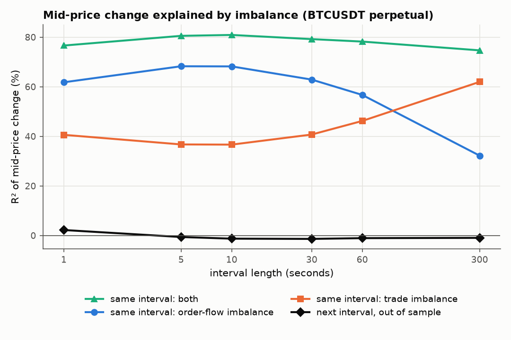
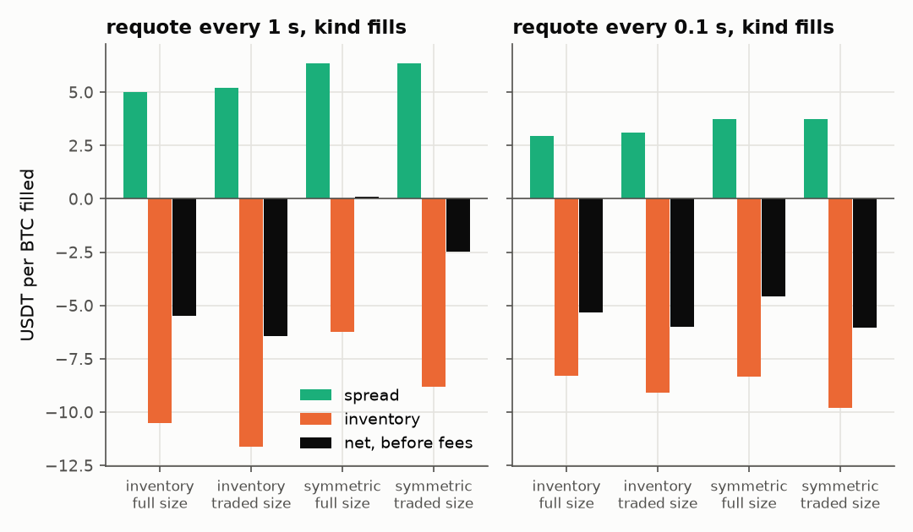

# Undertow

## The question

Does the imbalance between buy and sell pressure in the order book predict the next price move? And if you quoted both sides, would you keep the spread or lose it to inventory?

## The answer

Tested on five days of the Binance BTCUSDT perpetual future, from the free Binance public archive.

Order-flow imbalance explains 68% of the mid-price change over the same 10 seconds. Cont, Kukanov and Stoikov report 65% for US stocks.

It predicts the next second a little. Out of sample it calls the sign of the next one-second move right 62.7% of the time (95% interval 62.0% to 63.3%). Following that sign collects 0.085 basis points a second before costs, so any fee above that removes it. At 5 seconds the sign is still right 52.4% of the time (51.6% to 53.1%), worth 0.063 basis points. From 10 seconds on there is nothing.

A simulated Avellaneda-Stoikov quoter on the same tape loses money. With the paper's middle risk aversion, a one-second requote, and each fill capped by the volume that actually traded at its price, it earns 5.22 USDT of spread per BTC filled and gives back 11.64 on inventory. It lost on each of the four test days. The paper's inventory strategy lost on every test day in all 24 configurations tried, by 0.3 to 1.0 basis points of traded notional before fees.



The main limit: this is one instrument on one venue for five days, with the best bid and ask only. Four test days are enough to see that the inventory quoter loses. They are not enough to tell any profitable configuration from luck.

## Reproduce

```
uv sync
uv run python scripts/fetch_data.py     # about 0.9 GB into data/, no key or account
uv run python scripts/reproduce.py      # rebuilds results/
```

The first run reads about 8 GB of CSV out of the zip files and takes several minutes. Later runs use cached bars and trades and take about two minutes, most of it the quoter replay. On the machine that built them, a full run rewrites the committed `results/` byte for byte and `git status` stays clean.

`--fast` on both scripts uses part of one day. `reproduce.py --fast --synthetic` needs no download and runs on a toy tape. CI uses it.

## Results

All numbers are in `results/summary.md`. BTCUSDT perpetual, 2024-03-25 to 2024-03-29: 432,000 seconds and 70.5 million best-quote updates (`results/table0_sample.csv`).

### Imbalance and price change

Regressions in windows of 180 intervals, as in the paper. Each number is the average over windows. Intervals in brackets are 95% block-bootstrap intervals over windows (`results/table1c_ofi_bootstrap.csv`).

| Interval | Windows | OFI, same interval | Trade imbalance | Both | OFI, next interval, out of sample | Sign called right, out of sample |
|---|---|---|---|---|---|---|
| 1 s | 2399 | 61.8% [61.0, 62.6] | 40.6% | 76.6% | 2.2% [2.0, 2.5] | 62.7% [62.0, 63.3] |
| 5 s | 479 | 68.3% [67.0, 69.5] | 36.7% | 80.5% | -0.6% [-0.9, -0.3] | 52.4% [51.6, 53.1] |
| 10 s | 239 | 68.2% [66.5, 69.9] | 36.7% | 80.9% | -1.3% [-1.6, -1.0] | 49.9% [49.5, 50.4] |
| 30 s | 79 | 62.9% [60.3, 65.4] | 40.7% | 79.2% | -1.4% [-2.0, -0.8] | 49.5% [48.7, 50.2] |
| 60 s | 39 | 56.7% [53.4, 60.0] | 46.2% | 78.2% | -1.1% [-1.6, -0.6] | 50.7% [49.8, 51.7] |
| 300 s | 7 | 32.2% | 62.0% | 74.7% | -0.9% | 49.8% |

- The 10-second number holds on each of the five days separately: 64.6% to 71.8%.
- At one second, following the forecast's sign collects 5.9 ticks per second on average, 0.085 basis points of price (0.080 to 0.090). That assumes trading at the mid at the instant the second ends, with no fee.
- At 5 seconds the out-of-sample R-squared is below zero, so the size of the forecast is worse than predicting no change. Its sign is still right slightly more often than not, worth 0.063 basis points (0.046 to 0.081). At 10 seconds and beyond the sign gain's interval includes zero.
- The last price move alone forecasts less. The same out-of-sample forecast built from the last second's price change explains 0.3% and calls the sign right 57.8% of the time (57.3% to 58.4%).
- Trade imbalance adds 13 points on top of OFI. In the paper it adds 2.
- The impact slope falls with depth as the paper says, `beta = c / AD^lambda` with lambda of 1.06 (paper: 0.98). The constant is 4.3 against the paper's 0.45.
- The 300-second row has seven windows. Its intervals are not shown because seven windows cannot support them.

### The quoter

Fill rate and volatility are measured on the first day. The quoter runs on the other four (96 hours). It posts one bid and one ask of 1 BTC and requotes on a fixed interval. Its two free parameters are set to the paper's simulation in dimensionless form (see `PAPER.md`). Money is USDT, before fees.

Two rules decide fills. The fill rule says which trades reach the quote: kind (front of the queue, a trade at the quote price fills it) or unkind (back of the queue, only a trade through the price fills it). The size rule says how much fills: full (always the whole 1 BTC) or traded (capped by the taker volume that printed at the prices the fill rule counts). The traded rule is the more realistic one and is the headline.

Paper's gamma of 0.1, kind fills:

| Requote | Strategy | Size rule | BTC filled | Spread per BTC | Inventory per BTC | Net per BTC | Break-even fee | Profit per day, mean ± s.e. | Days with a profit |
|---|---|---|---|---|---|---|---|---|---|
| 1 s | Inventory | traded | 45,968 | 5.22 | -11.64 | -6.42 | -0.91 bps | -73,733 ± 14,716 | 0 of 4 |
| 1 s | Inventory | full | 69,622 | 5.02 | -10.51 | -5.49 | -0.78 bps | -95,533 ± 16,414 | 0 of 4 |
| 1 s | Symmetric | traded | 43,146 | 6.35 | -8.83 | -2.48 | -0.35 bps | -26,726 ± 62,493 | 2 of 4 |
| 1 s | Symmetric | full | 64,280 | 6.35 | -6.25 | 0.10 | 0.01 bps | 1,598 ± 37,216 | 2 of 4 |
| 0.1 s | Inventory | traded | 66,181 | 3.11 | -9.09 | -5.98 | -0.85 bps | -98,928 ± 23,116 | 0 of 4 |
| 0.1 s | Symmetric | traded | 62,185 | 3.75 | -9.79 | -6.04 | -0.86 bps | -93,912 ± 134,864 | 2 of 4 |



Table 5 in `results/` has all 48 configurations: two requote intervals, three risk aversions, two strategies, two fill rules and two size rules. Table 5b has the profit of each one on each day.

- The inventory strategy does what the paper says to inventory. At a one-second requote its position has a standard deviation of about 1 BTC against 73 to 115 for the symmetric quoter. It pays for that and has no profit to pay from. It lost on all four test days in every one of its 24 configurations. The day-level t-ratios run from -3.1 to -5.8.
- Capping fills at the traded volume makes the loss per BTC filled larger: 6.42 USDT against 5.49 for the inventory strategy at one second. The inventory loss per BTC grows more than the spread earned.
- The symmetric quoter at the paper's gamma of 0.1 goes from break-even to a loss under the traded rule. Its daily profit under that rule runs from -154,202 to +131,294 USDT, so neither result can be told from zero.
- A negative break-even fee means the quoter needs a rebate that large on every fill to reach zero.
- One benchmark configuration shows a profit: the symmetric quoter at the paper's gamma of 1, which quotes 22 to 37 USDT wide. It shows 3.5 to 5.2 basis points in all eight of its rows and made money on three of the four days. About half of it is gain on inventory. Its position has a standard deviation of 61 to 101 BTC and it ended each run 28 to 163 BTC long. The day-level t-ratios are 0.8 to 2.0 on three degrees of freedom, so four days cannot tell this from luck. The inventory strategy at the same gamma loses.
- The paper assumes a fill is independent of the next price move. On this tape a quote away from the best price fills when the price runs through it, and one-second price changes are positively autocorrelated (0.09), so the price tends to keep going.

The paper's own simulation replicates. Rerun with its parameters, profit and inventory match its three tables to within Monte Carlo error (`results/table3_paper_simulation.csv`).

### Spread estimators

On 305 daily bars the three estimators put the spread at 84 to 164 basis points. The quoted spread measured from the book is 0.016 basis points. On simulated prices with 3% daily volatility they report 30 to 120 basis points when the true spread is zero, and they recover a 200 basis point spread to within a quarter. They cannot see a spread this small.

## Comparison with the sources, in brief

| Claim | Source | Here |
|---|---|---|
| OFI explains 10-second price change | R-squared 65% | 68% |
| Trade imbalance alone | 32% | 37% |
| Trade imbalance adds little to OFI | 67% with both | 81% with both: it adds a lot |
| Impact slope is `c / AD^lambda` | lambda 0.98, c 0.45 | lambda 1.06, c 4.3 |
| Fit improves with longer intervals | stated | It peaks at 5 to 10 s and falls |
| Avellaneda-Stoikov simulation tables | 6 rows | Replicated |
| Inventory quoter is profitable, with less risk | yes | Less inventory, and a loss on every test day |

`PAPER.md` has every formula with its equation number, which version of each paper was read, and every number that differs from a source with the likely reason.

## Sources

- Cont, Kukanov and Stoikov, "The Price Impact of Order Book Events", Journal of Financial Econometrics 12(1), 2014
- Avellaneda and Stoikov, "High-frequency trading in a limit order book", Quantitative Finance 8(3), 2008
- Roll (1984), Corwin and Schultz (2012), Abdi and Ranaldo (2017) for the spread estimators

## Data

One source, the Binance public archive at `data.binance.vision`. It needs no key and no account. No data file is committed.

The files are USD-M futures `bookTicker` and `aggTrades` for BTCUSDT on five days, and daily `klines` for ten months. Every file is checked against the SHA-256 published next to it. The hashes are in `results/data_vintage.txt`. The archive holds `bookTicker` only from 2023-05-16 to 2024-03-30, which is why the sample is from March 2024.

The archive's terms of use (Binance Vision Dataset Terms, version 1.0, last updated 26 August 2026, read on 24 November 2026 at `data.binance.vision/terms-of-use.html`) license the data under CC BY-NC-SA 4.0. They list academic research and personal non-production backtesting among the permitted uses, and they require redistributed derivative work to credit Binance Vision and keep the same licence. So every file in `results/` is shared under CC BY-NC-SA 4.0 with attribution to Binance Vision, and the code is MIT. Binance does not sponsor or endorse this project.

## What this contains

- `ofi.py`: order-flow imbalance as Cont, Kukanov and Stoikov define it, and the window regressions
- `quoter.py`: the Avellaneda-Stoikov formulas, the paper's simulation, and a replay on archive trades with full or traded-size fills
- `stats.py`: the block bootstrap and the day-level standard errors
- `spread.py`: the Roll, Corwin-Schultz and Abdi-Ranaldo estimators, and a simulator to test them
- `data.py`, `experiments.py`, `synthetic.py`: loading, the tables, and a toy tape for tests

## How it is tested

89 tests. They run without any data.

- Each case of the order-flow rule is checked by hand: size changes, and each side moving up or down
- The regression is checked against exact fits, `numpy.polyfit`, and a hand-written White standard error
- The predictive regression is fed data where the price follows the previous interval's flow exactly, to prove it uses the lag
- The quoter's reservation price and spread match the paper's formulas, and its average spread matches the three published tables
- The paper's simulation is rerun and compared with its table 1
- Quotes and fills on short tapes are worked out by hand, including partial fills from traded volume, and profit is checked against separate cash bookkeeping on a random tape
- The traded volume at or through a price in each bar is checked by hand, and the per-step profit adds up to the total
- The bootstrap is checked on a constant series, against the normal interval on independent data, and for wider intervals on a persistent series
- The spread estimators are checked against hand calculations and against simulated prices with a known spread
- `reproduce` is run twice on the toy tape and its tables must be identical byte for byte

## Layout

```
src/undertow/      the code
tests/             maths tests first
scripts/reproduce.py   one command rebuilds every figure and table
scripts/fetch_data.py  downloads public data into data/ (never committed)
results/           committed figures and small tables
PAPER.md           citations, claims tested, comparison with the sources
```

## Limits

- Five days, one instrument, one week in March 2024. BTC rose 3.9% on the first day and volatility was high all week. The window averages are stable from day to day, but a calm week could differ.
- The quoter's test period is four days. Day-level standard errors treat each day as independent and have three degrees of freedom.
- The archive has the best bid and ask only. Depth behind the best quotes is not available for free, so order-flow imbalance is level one, and the explanations in `PAPER.md` that involve deeper levels are untested. This also means the one-second forecast cannot be split into the part that comes from the best queue running out and anything else.
- The archive's update ids are not consecutive, so a missing quote update cannot be detected.
- The quoter requotes once per second or once per 100 ms and cannot cancel in between. A real one reacts in microseconds. Shortening the interval tenfold did not change the sign of the result, but that is as far as this data goes.
- At most one fill per side per interval. The traded size rule caps a fill at the taker volume that printed at its price, but it cannot know the real queue in front of the quote.
- The two fill rules give nearly the same answer. Half of all one-second mid changes are a tick or less, but the mean absolute change is 31 ticks, so the quotes that fill are mostly the ones the price runs through. Queue position matters for quotes at the best price, and the quoter is rarely there.
- A simulated quoter does not move the market. A real one does.
- The one-second forecast assumes trading at the mid at the instant the bar ends. Nobody gets that price.
- The exponential fill curve fits the measured fill rate poorly (R-squared 0.66 and 0.82). The quoter's spread comes from that curve.
- One venue. Nothing was measured on a second exchange.
- Crypto books are not equity or futures books. Nothing here transfers without a new test.
- This is research code. It is not investment advice and it does not trade.

An undertow is the current under the surface that pulls the other way.

## Licence

Code: MIT. See `LICENSE`. Files in `results/`: CC BY-NC-SA 4.0, derived from Binance Vision data.
